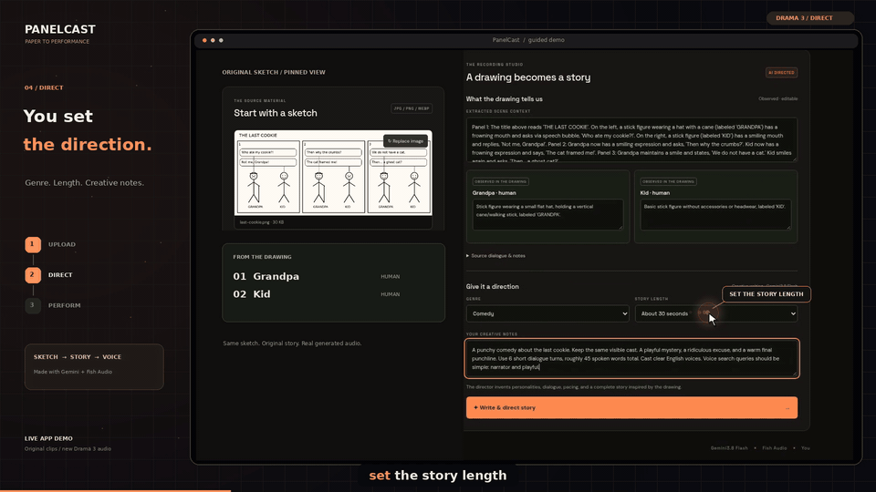

# PanelCast — sketch to directed audio story

An image supplies the characters and story seed. Google Gemini 3.8 Flash separates visible facts from invented personality, writes an original story, and directs the performance. Fish Audio speaks the finished drama using **s2.1-pro-free** or **drama-3**, selectable in the dashboard.

## Demo

[Watch or download the Drama 3 demo](demo/PanelCast-Drama3-Demo.mp4) — 76 seconds, 1080p, with a narrated walkthrough, animated cursor, camera-follow motion, click effects, synchronized captions, and the generated character performance.



See [demo files and production notes](demo/README.md) for captions and the standalone audio master.

## Start

Requirements: Python 3.10+, internet access, a Gemini API key with access to `gemini-3.8-flash`, and your Fish API key. No local model, GPU, or Ollama installation is required. Drama 3 requires your account to have access and credit; the free development model is subject to Fish's limits.

```bash
unzip PanelCast-Fixed.zip
cd sketch-radio
cp .env.example .env
# Edit .env and set GEMINI_API_KEY and FISH_API_KEY.
bash run.sh
```

Open **http://127.0.0.1:8000**. No frontend build or Node installation is required. The launch script installs Python dependencies in `.venv`.

Windows PowerShell:

```powershell
Copy-Item .env.example .env
python -m venv .venv
.venv\Scripts\python -m pip install -r backend/requirements.txt
.venv\Scripts\python -m uvicorn backend.main:app --host 127.0.0.1 --port 8000
```

## Update an existing installation

The fixed archive contains no `.env`, virtual environment or generated outputs. You can extract it over the existing project to keep your keys. For the folder shown in the reported error, after downloading the fixed archive to Downloads:

```bash
unzip -o "$HOME/Downloads/PanelCast-Fixed.zip" -d "$HOME/Downloads/PanelCast"
cd "$HOME/Downloads/PanelCast/sketch-radio"
.venv/bin/python diagnose.py --story
bash run.sh
```

Stop the old server before updating. Use the actual downloaded archive name if your browser added a suffix. The diagnostic makes live Gemini requests and needs your existing `.env`; it does not generate Fish audio.

## Three stages

### 1. Observe

Upload or photograph a comic of any panel count within the demo limits. Gemini identifies recurring visible characters and records their kind, visible traits, actions, source writing, and context. It should describe an ambiguous stick figure as a person, with unknown age/gender. Dogs remain dogs; a later anthropomorphic speaking role does not change their observed species.

The original speech bubbles are source evidence, not the final performance. You can edit observed traits and source context before writing the story. The model can still make visual mistakes: review this stage.

### 2. Write and direct

Choose genre, approximate story length, and creative instructions, then press **Write & direct story**. A separate text-only Gemini call creates an original opening, escalation, and payoff, using only the extracted cast. It adds clearly labeled invented personalities, voice profiles, new dialogue, emotion, delivery instructions, and pauses. The service preserves the extracted identity, species, and observed descriptions instead of letting the writer replace the cast.

Only Gemini writes the story. Fish performs the prepared text.

Example of useful creative instructions:

> A warm comedy. The dog is a tiny courtroom lawyer negotiating for biscuits. The human catches on, but the ending reveals real affection. Keep it intimate, with two voices, dry pauses and a final punchline. Do not repeat the speech bubbles.

Review and edit the generated dialogue and acting instructions before recording. Personality notes describe the creative character; voice and line directions control the current performance. A personality change by itself does not rewrite existing dialogue.

### 3. Perform

Choose **s2.1-pro-free** or **drama-3** in the dashboard. Switching models preserves the story, clears stale audio/preview, and compiles the next request for the selected model. No restart or `.env` edit is needed for switching.

- **Whole scene:** one native multi-speaker Fish request, with an ordered `reference_id` array and `<|speaker:N|>` turn markers. Full conversational context stays together. Delivery cues and pauses are approximate model instructions. No per-line timestamps or isolated line recordings are claimed.
- **Individual lines:** separate requests for each line, then WAV assembly. Silence durations and line timings are controlled locally; continuity can differ from a whole-scene performance. The final requested pause is also included.

Voice search/casting matches textual voice-library metadata against the creative role. It does not listen to or evaluate every candidate voice. You can search again or paste known Fish voice IDs.

Use **Compile TTS preview** to inspect the request text before synthesis. Prompt preview works without keys. Image analysis and story writing require the Gemini key; voice search and audio generation require the Fish key. Preview flags missing voice IDs. Recording tries to cast remaining voices and stops with an actionable error if it cannot.

## Prompting

The compiler owns speaker tokens, voice ordering, and bracket syntax. Dialogue remains spoken words; separate character/line fields carry direction. This avoids accidentally speaking labels like “old man” or “heavy voice” as dialogue.

A Drama 3 scene can look like:

```text
<|speaker:0|>[warm conversational voice; dry suspicion; curious] You arranged my slippers in a heart. What did you break? [short pause]
<|speaker:1|>[bright playful character voice; earnest flattery; confident] Nothing. I am celebrating your excellent taste in companions. [short pause]
```

The voice ID array maps speaker 0 to the person and speaker 1 to the dog. Speaker labels alone do not create or clone a voice.

Drama 3 receives plain-language delivery directions and natural pause cues. The S2.1 free model receives square-bracket directions plus `[break]` or `[long-break]` cues. These are performance requests, not guarantees. The current structured editor supports line-level directions and pauses between turns; it does not expose Drama 3's full phoneme or word-span markup surface. Refine a performance by listening and adjusting voice choice, dialogue length, and concise directions. No prompt can guarantee perfect audio.

## Included examples

- `examples/last-cookie.png`: a simple comic to upload through the real vision path.
- `examples/dog-treats-source.json`: a manually authored source summary based on the supplied person/dog example, explicitly labeled as manual.
- `examples/dog-treats-directed.json`: an original, manually authored adaptation illustrating personality and performance fields. It contains no live generated audio or assigned real voice IDs.
- `examples/drama-3-prompt.txt` and `examples/s2.1-pro-free-prompt.txt`: compiled performance text for the manual person/dog story; voice IDs still need casting.
- The dashboard's source sample lets you rehearse the writer/casting flow without an image. It is clearly labeled sample content.

JSON examples are API fixtures, not files the image picker accepts. For example, after the server is running:

```bash
curl -s http://127.0.0.1:8000/api/preview \
  -H 'Content-Type: application/json' \
  --data-binary @examples/dog-treats-directed.json
```

## Configuration

| Variable | Purpose |
| --- | --- |
| `FISH_API_KEY` | Server-side Fish authentication |
| `FISH_MODEL` | Initial/default model: `s2.1-pro-free` or `drama-3`; explicit dashboard selection controls requests |
| `FISH_DEFAULT_VOICE_ID` | Optional known voice when automatic casting finds no match |
| `GEMINI_API_KEY` | Server-side Google Gemini API key |
| `GEMINI_MODEL` | Vision and creative writer; defaults to `gemini-3.8-flash` |
| `PORT` | Launch-script port; default 8000 |

If an older `.env` contains another Fish model, the default maps to `s2.1-pro-free` with a health warning. Explicit unsupported model values in API requests are rejected. No generation silently substitutes one of the two dashboard models for the other.

## API

| Endpoint | Payload | Result |
| --- | --- | --- |
| `GET /api/health` | none | Service/model setup status |
| `POST /api/analyze` | multipart `image` | Observed cast, context, source speech; no creative personality |
| `POST /api/direct` | `{source, model, genre, instructions, target_seconds}` | Original directed story and optional Fish casting |
| `POST /api/preview` | story JSON | Compiled prompt and speaker map; no synthesis |
| `GET /api/voices?q=...` | search phrase | Fish library candidates |
| `POST /api/render` | story JSON with `tts_model`, `render_mode` | WAV URL, model, cast, prompt, duration; timed segments only in per-line mode |

Directing accepts a 15–120 second target; actual duration is approximate. Demo limits: 8 characters, 24 spoken turns, 6000 spoken characters, 12 MB / 25 megapixel input. Native scenes may contain generated scene beats beyond the original panels.

## Check your live Gemini connection

From the project directory, after dependencies are installed:

```bash
.venv/bin/python diagnose.py --story
```

This reads the local `.env` and makes three live Gemini checks: a small text/JSON request, the actual comic extraction path using the included sample image, and the actual story-writing path. It does not call Fish or print keys. Provider usage may be billed; a rejected JSON-mode configuration can trigger one compatibility retry. Use `--image /path/to/comic.png` to check your own image. If a check fails, it exits with a nonzero status and names the failed stage. A pass confirms these requests on your account at that moment, not every possible image or Fish audio.

Gemini requests now use only JSON MIME configuration; no API-enforced schema, thinking, temperature, or token-limit flags are sent. The desired JSON shape is described in the prompt and validated locally. A generic invalid-argument response or an unsupported JSON-mode configuration gets one retry without generation configuration, keeping the same model and input. Authentication, access, safety, billing, quota and timeout failures are not retried. This reduces configuration-related rejection points; it does not establish the cause of a generic provider error.

## Rehearsal and limits

Twenty seconds is a target, not a measured guarantee. There are two Gemini API calls: vision and writing, followed by Fish synthesis. Network latency, model processing, provider quotas, Fish queueing, and output length all matter. Start with a 30-second story and rehearse on your event connection.

Get a Gemini key at https://aistudio.google.com/apikey and place it in `.env`. Restart after editing configuration. A previous `.env` containing only Ollama settings will not enable Gemini; add the new key and model fields. Health shows whether keys are configured, not whether your account/model access has been verified. Gemini 400/403/429 errors include an actionable explanation; check model access, API restrictions, billing and quota. Do not paste keys into the browser or share them in logs.

For Fish authorization or credit errors, check the key, model access and balance. No live account access is verified by merely choosing a model in the dropdown. Voice IDs must be usable by the selected model/account.

This is a single-user local demo. Images and source context are sent to Google Gemini for analysis and story writing; derived story text and voice queries go to Fish. Both keys stay on the server. Generated audio remains under `outputs/` until you delete it. Do not expose the unauthenticated development server directly to the public internet. For phone photos, transfer the image to your laptop and use upload; a phone cannot access your laptop via `127.0.0.1`.

## Validation

```bash
.venv/bin/python -m pip install -r requirements-dev.txt
.venv/bin/python -m pytest -q
node --check frontend/app.js  # optional, if Node is installed
```

Automated tests mock upstream services. They verify payloads and output handling, not real voice quality, visual recognition accuracy or latency. See `VALIDATION.md` for completed checks and limits.

## Official API references

- Drama 3: https://docs.fish.audio/features/text-to-speech/drama-3
- Fish TTS and native dialogue: https://docs.fish.audio/api-reference/endpoint/openapi-v1/text-to-speech
- Fish voice library: https://docs.fish.audio/api-reference/endpoint/model/list-models
- S2 direction cues: https://docs.fish.audio/developer-guide/core-features/emotions
- Gemini 3.8 Flash: https://ai.google.dev/gemini-api/docs/models/gemini-3.8-flash
- Gemini structured output: https://ai.google.dev/gemini-api/docs/structured-output
- Gemini GenerateContent API: https://ai.google.dev/api/generate-content
